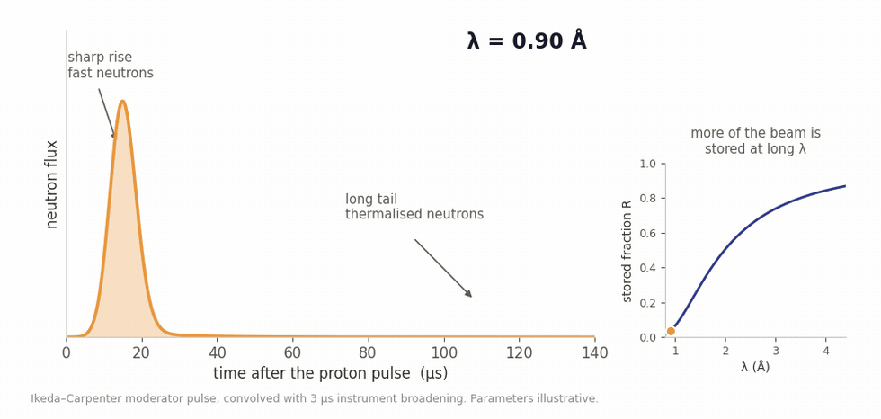
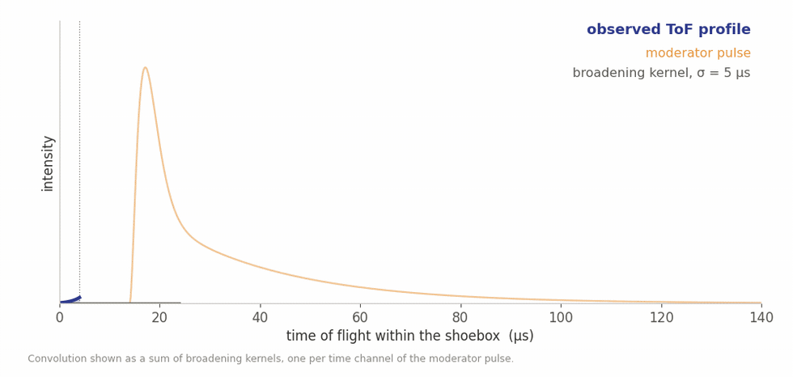
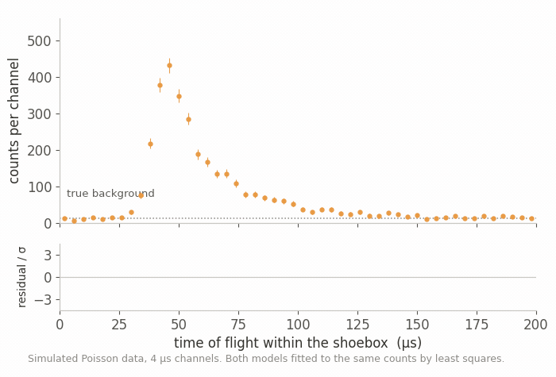
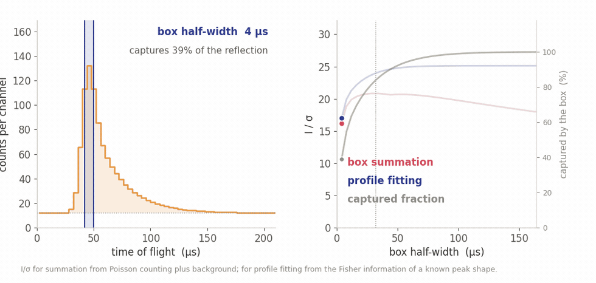
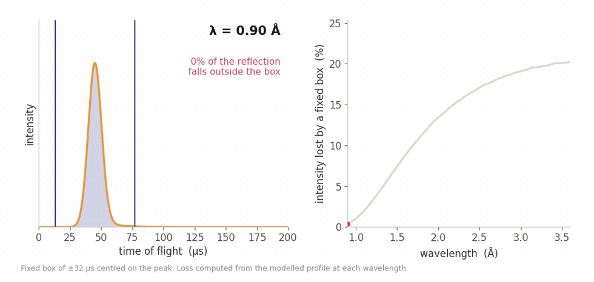
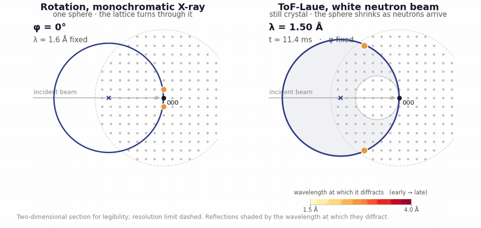
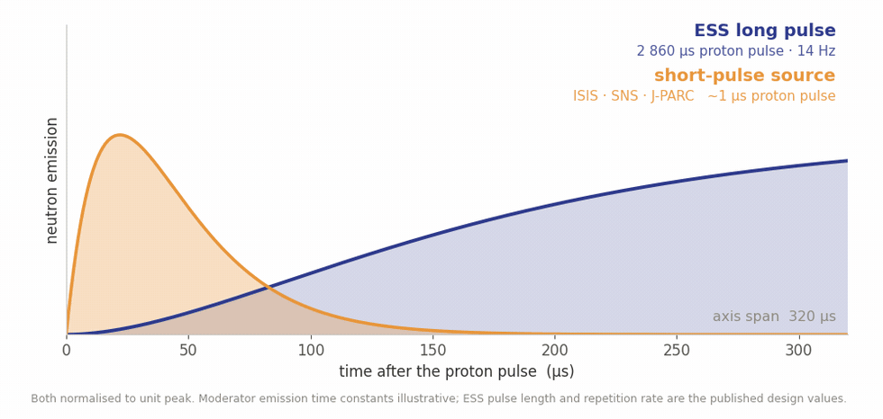
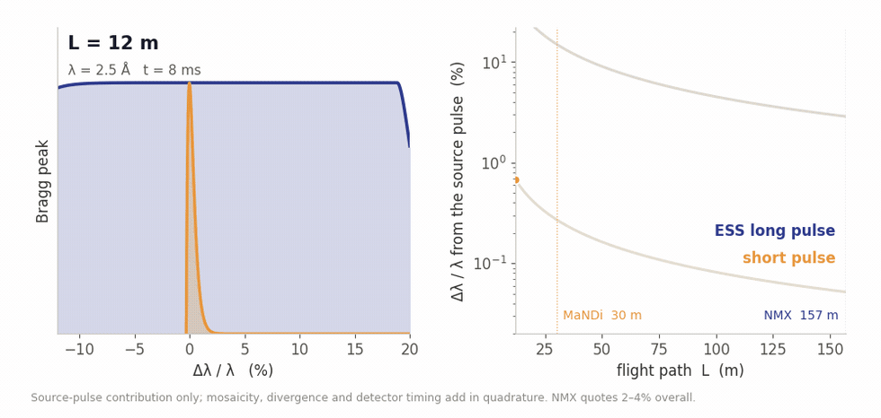
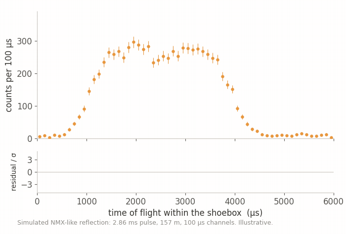

This post walks through five ideas, in order. The moderator pulse is asymmetric. That asymmetry survives into every recorded peak. A symmetric model cannot fit it. Box summation forces a bad trade between capturing the tail and collecting background. And the loss depends on wavelength, so scaling cannot simply absorb it. The tool in question is <code>dials.tof_integrate</code>, with <code>method = profile_1d | profile_3d_gutmann | profile_3d_ic</code>.

<h2>1. A neutron pulse is not symmetric in time</h2>
<figure>
  
  <figcaption>The moderator pulse shape as a function of wavelength.</figcaption>
</figure>

Fast neutrons leave the moderator promptly and give the sharp rising edge. Neutrons that thermalise inside the moderator leak out slowly and form the long tail. The stored fraction <i>R</i> climbs steeply with wavelength, so long-λ pulses are far more asymmetric than short-λ ones.

The Ikeda–Carpenter form has a fast decay α, a slow decay β, and a mixing ratio <i>R</i>. At 1 Å the pulse is nearly symmetric; at 4 Å it is emphatically not. That wavelength dependence is what makes this a data-quality problem rather than a curiosity.

<h2>2. Every reflection inherits that shape</h2>
<figure>
  
  <figcaption>One broadening kernel is laid down per time channel of the moderator pulse, and the result is accumulated.</figcaption>
</figure>

The recorded peak is the moderator pulse convolved with mosaicity, chopper and detector response. Convolution blurs the peak. It does not make it symmetric, and no amount of instrumental broadening turns an asymmetric pulse into a Gaussian. In a shoebox the ToF axis is the third dimension, so this asymmetry lives in <i>z</i>, not in <i>x</i> and <i>y</i>.

<h2>3. A symmetric model cannot fit an asymmetric peak</h2>
<figure>
  
  <figcaption>Both curves are genuine least-squares fits to the same simulated Poisson data.</figcaption>
</figure>

  
<b>70.7%</b>recovered by a Gaussian fit

  
<b>100.0%</b>recovered by Ikeda–Carpenter

The Gaussian buries the tail in a background it inflates from 12 to 28 counts per channel. Structured residuals mean the model is wrong, not that the data are noisy.

The Gaussian is not badly fitted. It is the best possible Gaussian, and it still loses nearly a third of the intensity. The background line is where the missing intensity goes.

<h2>4. Summing a box forces a bad trade</h2>
<figure>
  
  <figcaption>Precision and accuracy peak at different box widths.</figcaption>
</figure>

  
<b>±32 µs</b>box half-width that maximises I/σ

  
<b>16%</b>of the reflection that box still discards

Tighten the box and you cut the tail; widen it and background noise swamps the gain. The optimum for precision is not the optimum for accuracy, because they peak at different widths. Profile fitting has no such trade: extra channels constrain the model rather than diluting it.

I/σ for summation comes from Poisson counting plus background; for profile fitting it comes from the Fisher information of a peak whose shape is known. The gain here is about 20 percent in I/σ, which is typical. The larger win is in the bias, below.

<h2>5. And the loss will not scale away</h2>
<figure>
  
  <figcaption>Fraction of intensity discarded by a fixed box across the wavelength band.</figcaption>
</figure>

  
<b>0.4% → 19%</b>intensity lost by a fixed box, 0.9 to 3.6 Å

A fixed box discards a wavelength-dependent fraction of every reflection. That is a systematic which varies smoothly across the band, which is precisely the kind scaling struggles to separate from real structure factors. Fitting the peak shape removes the bias at source instead of modelling it downstream.

A constant fractional loss would be absorbed by an overall scale factor. A loss that tracks wavelength will not be. The tail fraction from the first section becomes a systematic error here.

<h2>Coming from rotation MX: what changes, and what doesn't</h2>

Still a shoebox, still a background plane, still profile fitting — but the third axis is wavelength, not φ. Almost all the machinery transfers: spot finding, indexing, refinement, shoeboxes, background planes, profile fitting, scaling. What changes is what the third dimension of the shoebox means, and therefore what sets the peak width.

<h2>Same reciprocal lattice, two ways of reaching it</h2>
<figure>
  
  <figcaption>Left: rotation, one Ewald sphere, the crystal turns through it. Right: ToF-Laue, a still crystal, the sphere sweeps by itself. Points are shaded by the wavelength at which they diffract.</figcaption>
</figure>

Rotation is monochromatic: one sphere of radius 1/λ, and φ is the scan variable you control. A white beam fills the volume between the spheres at λmin and λmax, so every reflection in that shell is already in diffracting condition and no scan is needed. Because time of flight sorts neutrons by wavelength, the sphere really does shrink through the lattice as the frame progresses. High-angle reflections come early and low-angle ones late. Both panels accumulate: the same reflections get recorded either way.

<h2>Stills, not a scan — and what follows from it</h2>
<table>
  <thead><tr><th></th><th>Rotation X-ray</th><th>ToF-Laue neutron</th></tr></thead>
  <tbody>
    <tr><td>Third axis of the shoebox</td><td>φ, the rotation angle</td><td>t, the time of flight ≡ λ</td></tr>
    <tr><td>Set by</td><td>crystal: mosaicity + divergence</td><td>instrument: the source pulse</td></tr>
    <tr><td>Peak profile in that axis</td><td>the rocking curve</td><td>the moderator pulse shape</td></tr>
    <tr><td>Partiality</td><td>clipped between images</td><td>clipped at the edges of the band</td></tr>
    <tr><td>Lorentz factor</td><td>rotation geometry</td><td>sin²θ / λ⁴, per pixel</td></tr>
    <tr><td>Harmonic overlap</td><td>does not arise</td><td>resolved — nλ arrive at different t</td></tr>
    <tr><td>Spatially overlapped spots</td><td>separate in φ</td><td>can separate in t</td></tr>
    <tr><td>Background</td><td>per image</td><td>spread along t, so peaks sit above it</td></tr>
  </tbody>
</table>

<strong>Where the picture misleads.</strong> The sphere really does sweep, but the width of the peak in t is not the width of the sweep. It is dominated by the source pulse. A rocking curve tells you about the crystal; a ToF profile mostly tells you about the moderator.

The row to dwell on is the second one. In rotation, the width of a reflection in φ is a property of the crystal, which is why a rocking curve is diagnostic. In ToF-Laue the width in t is set by the moderator emission function, or at ESS by the proton pulse. It is largely the same for every reflection at a given wavelength, and it tells you almost nothing about crystal quality. That is also why the profile model is a pulse shape rather than a Gaussian.

Harmonic overlap deserves a sentence. In a monochromatic experiment it does not arise. In film Laue it is the classic headache, because <i>hkl</i> and <i>2h 2k 2l</i> diffract in the same direction. Time of flight separates them, because λ and λ/2 arrive at different times.

<h2>Part two: the ESS long pulse</h2>

<strong>2.86 ms instead of microseconds — and a different peak shape entirely.</strong> Everything so far assumed a short-pulse source, where the moderator sets the pulse width. At ESS the accelerator sets it, and it is about two hundred times longer.

<h2>Short and long pulse are different measurements</h2>
<figure>
  
  <figcaption>Both curves are normalised to unit peak. The time axis zooms from 320 µs out to 4.2 ms. Moderator emission time constants are illustrative; 2.86 ms and 14 Hz are the published ESS design values.</figcaption>
</figure>

  
<b>2.86 ms</b>ESS proton pulse length, at 14 Hz

  
<b>~1 µs</b>proton pulse at ISIS, SNS, J-PARC

At a short-pulse source the neutron pulse width is set by the moderator; at ESS it is set by the accelerator. The long pulse is the flux trade: far more neutrons per pulse, at the cost of time resolution.

<h2>Length buys the resolution back</h2>
<figure>
  
  <figcaption>Source-pulse term only; mosaicity, divergence and detector timing add in quadrature.</figcaption>
</figure>

  
<b>157 m</b>NMX sample distance from the moderator

  
<b>2.9%</b>Δλ/λ from the pulse at that distance

Δd/d ≈ Δt/t, and t grows linearly with flight path, so distance is the lever. The same 2.86 ms pulse at MaNDi's 30 m would give 15% in Δλ/λ, which is unusable. ESS runs at 14 Hz rather than 60 Hz, and the longer frame period hands back the bandwidth the long instrument would otherwise lose.

As a cross-check, 2.86 ms over a 99 ms flight time (2.5 Å at 157 m) gives 2.9 percent, inside the 2 to 4 percent NMX quotes. For bandwidth, a 71.43 ms frame at 157 m gives 1.8 Å, against 2.2 Å for a 16.67 ms frame at MaNDi's 30 m.

<h2>A long-pulse peak has a flat top</h2>
<figure>
  
  <figcaption>Simulated NMX-like reflection: 2.86 ms pulse, 157 m, 100 µs channels, 0.25 percent mosaic spread.</figcaption>
</figure>

  
<b>17.0</b>χ²/ν, Ikeda–Carpenter model

  
<b>0.96</b>χ²/ν, rect ⊗ emission ⊗ Gaussian

The pulse length dominates every other contribution, so the Bragg peak is essentially the source pulse shape: a trapezoid, not a peak. All three DIALS ToF profile models are single-peaked, and none of them has a plateau. Long-pulse data needs a fourth shape, with the plateau width as a parameter.

The flat-top model is a rectangle convolved with the moderator emission function and then a Gaussian. It is seeded at the known design pulse length, which a real implementation would also know. The practical conclusion: profile fitting matters at ESS too, but the existing models do not transfer.

<h2>Two quasi-Laue diffractometers, two regimes</h2>
<table>
  <thead><tr><th></th><th>MaNDi · SNS</th><th>NMX · ESS</th></tr></thead>
  <tbody>
    <tr><td>Proton pulse</td><td>~1 µs</td><td>2.86 ms</td></tr>
    <tr><td>Repetition rate</td><td>60 Hz</td><td>14 Hz</td></tr>
    <tr><td>Sample distance</td><td>30 m</td><td>157 m</td></tr>
    <tr><td>Flight time at 2.5 Å</td><td>19 ms</td><td>99 ms</td></tr>
    <tr><td>Bandwidth per frame</td><td>2.2 Å</td><td>1.8 Å</td></tr>
    <tr><td>Δλ/λ from the pulse</td><td>0.3%</td><td>2.9%</td></tr>
    <tr><td>Peak shape in ToF</td><td>asymmetric, tailed</td><td>flat-topped trapezoid</td></tr>
  </tbody>
</table>

Flight times, bandwidths and Δλ/λ are computed from the published pulse and geometry figures; MaNDi quotes 2.15 Å bandwidth and NMX quotes 2–4% overall wavelength resolution. The two bandwidth numbers are close despite the instruments differing by a factor of five in length, because ESS runs at 14 Hz rather than 60 Hz.

<h2>What DIALS does about it</h2>

The integrator is <code>dials.tof_integrate</code>, selected with <code>method =</code>:

<table>
  <thead><tr><th>Method</th><th>Reference</th><th>Model</th></tr></thead>
  <tbody>
    <tr><td><code>profile_1d</code></td><td>Yano et al., iBIX</td><td>Back-to-back exponential ⊗ Gaussian, fitted to the ToF projection.</td></tr>
    <tr><td><code>profile_3d_gutmann</code></td><td>Gutmann</td><td>Trivariate Gaussian in (x, y, t) with a back-to-back exponential tail.</td></tr>
    <tr><td><code>profile_3d_ic</code></td><td>separable IC × BVG</td><td>Ikeda–Carpenter pulse × bivariate Gaussian, separable and analytically differentiable.</td></tr>
    <tr><td><em>— not yet —</em></td><td>needed for ESS / NMX</td><td>A flat-topped model for long-pulse sources: rectangle ⊗ emission ⊗ Gaussian.</td></tr>
  </tbody>
</table>

<code>method=summation</code> is the fallback, not the default answer — and none of these has a plateau.

All three existing models fit an amplitude analytically by weighted least squares and refine only the shape parameters, which removes the most correlated direction from the optimisation. <code>profile_3d_ic</code> can hold the moderator parameters A, B and R fixed at calibrated values via <code>optimize_moderator_params=False</code>, so only per-reflection shape and position are refined.

