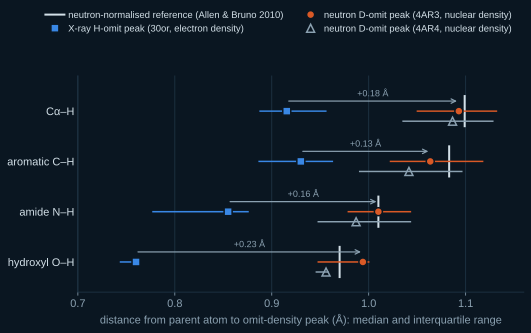
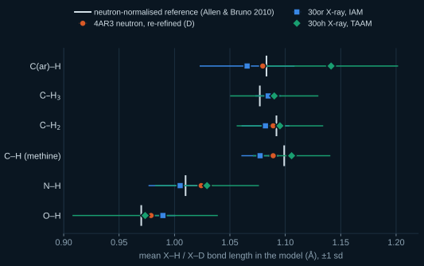
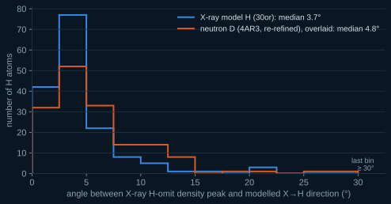
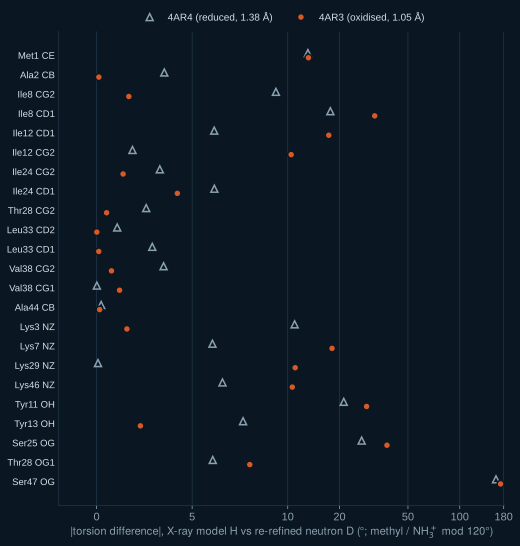
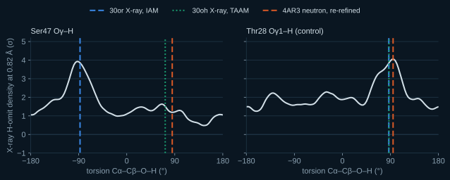
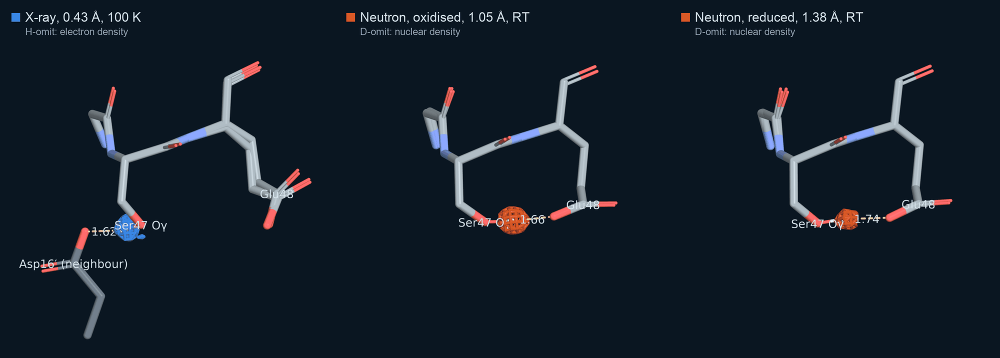
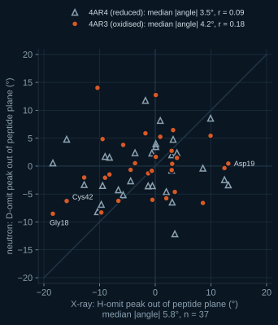
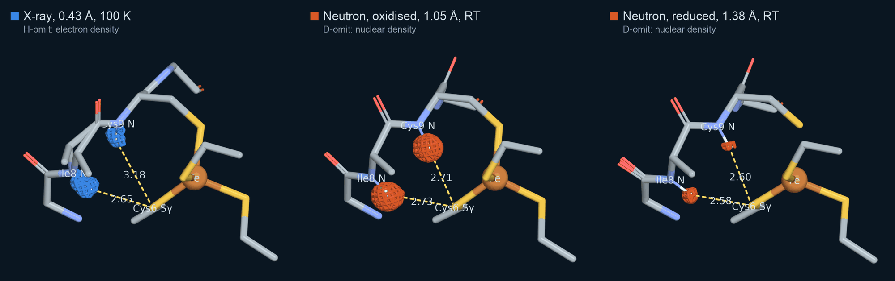

Paknia <i>et al.</i> have just published a 0.43 Å X-ray structure of <i>Pyrococcus abyssi</i> rubredoxin, the highest-resolution protein structure determined so far (<a href="https://doi.org/10.1107/S2059798326007448">Acta Cryst. D82, 1044–1055</a>). It is deposited twice: with transferable aspherical atom model (TAAM) scattering factors as <b>30oh</b>, and with the standard independent atom model (IAM) as <b>30or</b>. Every protein H atom is modelled, and the authors confirm each one with H-omit maps.

Rubredoxin is also a classic neutron crystallography protein, so the obvious question is how X-ray H positions at 0.43 Å compare with neutron D positions. The best neutron data are for perdeuterated <i>P. furiosus</i> rubredoxin, measured on ILL D19 at room temperature: oxidised to 1.05 Å and reduced to 1.38 Å (<a href="https://doi.org/10.1002/anie.201207071">Cuypers <i>et al.</i>, Angew. Chem. 52, 1022</a>). I re-refined both against their deposited structure factors in phenix.refine, with deuteriums restrained to proper nuclear X–D distances. Those re-refined models, and D-omit maps computed from them, are the neutron side of everything below.

The short answer: the two experiments agree on <b>where the hydrogens point</b>, to about 3° for X–H directions and about 1° for methyl rotors. They differ, as they should, on <b>how far out the hydrogens sit</b>. The X-ray data see the hydrogen's electron density, and the neutron data see the deuterium nucleus 0.13–0.23 Å further out. The real structural differences are few, and they are interesting. The 0.43 Å data show backbone N–H bonds tilting out of the peptide plane. A few hydroxyls and one N–H···S hydrogen bond at the iron site differ between the two crystals. On inspection, those differences track crystal packing and solvent rather than the protein itself.

  
<b>0.13–0.23&nbsp;Å</b>from the X-ray H peak (electrons) to the neutron D peak (nucleus), measured from the data

  
<b>3.0°</b>median angle between X-ray X→H and neutron X→D (non-rotating H)

  
<b>1.3°</b>median methyl torsion difference, X-ray vs neutron

  
<b>5.8°</b>median out-of-plane tilt of backbone N–H in the X-ray density

<h2>1. What is being compared</h2>
<table>
  <thead><tr><th></th><th>X-ray: 30oh / 30or</th><th>Neutron: 4AR3 / 4AR4, re-refined</th></tr></thead>
  <tbody>
    <tr><td>Protein</td><td><i>P. abyssi</i> Rd, W4L/R5S</td><td><i>P. furiosus</i> Rd, perdeuterated; oxidised / reduced</td></tr>
    <tr><td>Data</td><td>0.43 Å, 100 K</td><td>ILL D19, 1.05 / 1.38 Å, room temperature</td></tr>
    <tr><td>Refinement</td><td>BUSTER; TAAM (30oh) or IAM (30or). H in the "hybrid" model: nuclear X–H distances, moved to the electron position only for Fc</td><td>phenix.refine 1.19.2, neutron scattering lengths, D individually refined and restrained to nuclear X–D distances. R/Rfree 19.1/22.2% (oxidised), 15.5/20.4% (reduced)</td></tr>
  </tbody>
</table>

Every comparison is therefore 100 K against room temperature, as well as <i>P. abyssi</i> against <i>P. furiosus</i>. The sequences align without gaps, with <i>P. abyssi</i> numbering one higher (Cys6/9/39/42 against Cys5/8/38/41). Seven positions differ. I compared only residues that are identical in both, which gives 312 H/D pairs, and I use <i>P. abyssi</i> numbering throughout. The oxidised structure (1.05 Å) is the main reference; the reduced one comes in where the iron's redox state matters.

<h2>2. Where each experiment puts the hydrogen</h2>

Both datasets can locate the hydrogens without relying on a model. On the X-ray side, I built an H-omit map from the deposited 30or coefficients: the deposited mFo−DFc, plus <i>D</i>·Fc for the hydrogens alone. On the neutron side, I computed σA-weighted D-omit maps from the re-refined models, each omitting one of two non-overlapping sets of deuteriums: backbone amide and hydroxyl D in one map, Cα and aromatic ring D in the other. 311 of 389 hydrogens have an X-ray omit peak above 3σ. The omitted deuteriums come back at a median 6.7–8.6σ.

<figure>
  
  <figcaption>Distance from the parent atom to the omit-density peak: hydrogens in the 0.43 Å X-ray electron density, and deuteriums in the oxidised (1.05 Å) and reduced (1.38 Å) neutron nuclear density. White ticks are nuclear reference values. Arrows mark the shift from electron to nucleus.</figcaption>
</figure>

This is the textbook difference between the two probes, measured directly. The X-ray peaks sit where a hydrogen's electron density is, pulled into the bond: Cα–H 0.92 Å, aromatic C–H 0.93 Å, amide N–H 0.86 Å, hydroxyl O–H 0.76 Å. The neutron peaks sit at the nucleus: 1.09, 1.06, 1.01 and 0.99 Å in the 1.05 Å data, all within about 0.02 Å of the neutron-normalised reference values. The 1.38 Å data give 1.09, 1.04, 0.99 and 0.96 Å. The shift from electron to nucleus is 0.13–0.23 Å, largest for the polar O–H and N–H bonds.

To check that the peak search itself isn't biased, I made synthetic neutron data on the same reflection sets and ran the identical procedure. It recovers the true X–D distance to within 0.01 Å at 1.05 Å, and within 0.03 Å at 1.38 Å.

<h2>3. Bond lengths in the models</h2>
<figure>
  
  <figcaption>Mean bond length per bond type in each model (±1 sd). White ticks are neutron-normalised reference values.</figcaption>
</figure>

All three models are meant to hold nuclear X–H distances. The re-refined neutron model does: C–D 1.08–1.09 Å, N–D 1.02 Å, O–D 0.98 Å. It is restrained to those targets, so the D-omit peaks in section 2 are the independent evidence that the neutron data agree with them. The IAM X-ray model 30or also sits within about 0.02 Å of the references.

The TAAM X-ray model 30oh is less clean. Its aromatic C–H bonds average 1.14 Å and reach 1.21 Å. One likely cause is that the shift toward the bond is counted twice: BUSTER moves H to its electron position for Fc, and the TAAM hydrogen multipoles already put density into the bond, so refinement pushes the nucleus outward to compensate. Ser47 in 30oh is an exception the other way: its H atoms sit at electron-cloud distances (N–H 0.90 Å, O–H 0.85 Å), unlike the rest of the model.

<h2>4. Directions agree</h2>

For each matched pair, I superposed the parent atom and two bonded heavy atoms of the neutron model onto 30or. I then measured the angle between X→H and the transferred X→D. For H atoms that cannot rotate (backbone N–H, Cα–H, CH₂, aromatic CH), the median angle is <b>3.0°</b> for the oxidised structure and 3.2° for the reduced one.

<figure>
  
  <figcaption>For the 159 non-rotating H atoms with an X-ray omit peak above 4σ: how far the omit-density maximum sits from each model's X→H direction.</figcaption>
</figure>

The X-ray omit peak is a median 3.7° from the X-ray H and 4.8° from the neutron D. In 119 of 159 cases the X-ray density is higher along the X-ray direction. That is the expected result for a 100 K model of this protein compared with a room-temperature model of a homologue.

The non-rotating side-chain hydrogens that differ by more than 12° all sit on residues whose conformations differ: Pro40 Hβ3 (27°, different ring pucker), Glu53 Hβ3 at the disordered C-terminus (24°), and Hε of Lys3 and Lys29 (12–14°). The backbone N–H differences are a separate story (section 6).

<h2>5. Rotatable groups</h2>

For methyls, hydroxyls and Lys NH₃⁺, I compared torsions directly, with three-fold rotors compared modulo 120°. I also scanned the X-ray omit density around each rotor at tetrahedral geometry.

<figure>
  
  <figcaption>Torsion difference between the X-ray model H and the re-refined neutron D, per rotor (log-like axis above 10°).</figcaption>
</figure>
<ul>
  <li><b>Methyls.</b> The median difference is <b>1.3°</b> against the oxidised structure (14 groups) and 3.4° against the reduced one. The largest is Ile8 Cδ1, at 32° and 18°, where the X-ray torsional contrast is weak (1.6σ).</li>
  <li><b>Lys NH₃⁺.</b> 0–18°. The X-ray groups are staggered, and the omit scans agree, except for Lys7, whose X-ray density has almost no torsional contrast.</li>
  <li><b>Thr28 Oγ1–H and Tyr13 OH.</b> Within 8°.</li>
  <li><b>Tyr11 OH.</b> 29° (oxidised) and 21° (reduced). The X-ray omit density peaks at 4σ, 2° from the X-ray model. The neutron D-omit peaks, at +15° and +10°, confirm the neutron models, which sit at +17° and +10°. Both sides are data-supported, so this is a real difference. The OH donates to a water in both crystals, but not the same one, so it reflects the solvent structure rather than the protein.</li>
  <li><b>Ser25 Oγ–H.</b> 27–38° apart. The neutron D-omit peaks are clear (+105° to +115°), but Ser25 has three conformers in the X-ray model and only a weak (about 2σ) X-ray peak at +74° to +78°. Its surroundings differ too: waters and a symmetry-related Glu50 in the X-ray crystal, a water and a D₃O⁺ ion in the neutron crystal.</li>
  <li><b>Ser47 Oγ–H.</b> 163–173° apart, pointing in opposite directions. A crystal-packing difference, below.</li>
</ul>
<figure>
  
  <figcaption>X-ray H-omit density sampled 0.82 Å from the oxygen as the hydroxyl H rotates. Thr28 is a control where all models agree.</figcaption>
</figure>

In the X-ray crystal, Ser47 Oγ is 2.56 Å from Oδ2 of Asp16 in the <i>neighbouring</i> molecule, one lattice translation along <i>a</i>. It is a crystal contact. The IAM model points the hydroxyl H at that carboxylate (−88°), and the X-ray omit map has a 3.9σ peak there. The neutron crystal packs differently. There the equivalent Ser46 donates to its own Glu47 Oε2 (2.64–2.71 Å): the D points there (+75° to +85°), and the D-omit peaks (+79° to +81°, 7–9σ) confirm it. So the hydroxyl H is placed correctly in both structures. It simply has a different partner in each crystal, and the difference is a packing effect, not a property of the protein.

<figure>
  
  <figcaption>The Ser47 hydroxyl. Left: X-ray H-omit map (electron density, 2.0σ); the H points at Asp16′ of a neighbouring molecule in the crystal. Middle and right: neutron D-omit maps (nuclear density, 5σ) from the re-refined oxidised and reduced structures; the D points at the protein's own Glu48 (Glu47 in <i>P. furiosus</i>). Neutron models are superposed on the Ser47 backbone; dashed lines show H···O distances in Å from the models. Click for full size.</figcaption>
</figure>

The TAAM X-ray model 30oh puts this H at +72°, close to the neutron position, with the odd short bonds noted above. Its own residual map shows no missing density at −88°. The IAM omit peak may therefore include some Oγ lone-pair density that TAAM models and IAM does not. The X-ray answer for this one hydroxyl depends on the scattering model, which is a nice illustration of why TAAM matters for H atoms.

<h2>6. Backbone N–H: the X-ray data see pyramidalisation</h2>

A handful of backbone N–H bonds stand out in the direction comparison: Gly18, Asp19, Cys6, Cys9 and Ser25 differ by 10–14° from the neutron D. In every case the X-ray omit peak sits on the X-ray H. The reason is that the X-ray H atoms are out of the peptide plane, and the data support it.

<figure class="narrow">
  
  <figcaption>Angle of the N–H out of the C(i−1)–N–Cα plane, from the X-ray H-omit peak (x) and the neutron D-omit peak (y). Both axes come from omit maps, not from refined models. Points on the diagonal agree.</figcaption>
</figure>

In 30or, the N–H bonds leave the C(i−1)–N–Cα plane by a median of 5.6°, up to 18° for Gly18. The X-ray omit peaks reproduce this independently of the model: median 5.8°, with a correlation of 0.93 between peak and model.

The neutron D-omit peaks also leave the plane, by a median of 4.2° (oxidised) and 3.5° (reduced), but they barely track the X-ray tilts residue by residue (r = 0.18 and 0.09). Some agree well in the 1.05 Å data: Gly18 (−9° against −18° in the X-ray data), Cys42 (−6° against −16°), Glu31 (−8° against −10°) and Asp16 (+5° against +10°). Others point the other way. At 1.05 Å, the direction of a D-omit peak is only good to about 3–5°, which is the median scatter between peak and refined model and the same size as the tilts. So the room-temperature neutron data can neither confirm nor refute the X-ray pattern residue by residue. The refined neutron models don't help either: with standard peptide-plane restraints, the amides refine to a median of 0.9–1.2°.

Amide nitrogen pyramidalisation is well known from small-molecule and ultra-high-resolution work. Seeing it directly in the X-ray H density of a protein is one of the nicer things 0.43 Å data allow.

<h2>7. The NH···Sγ hydrogen bonds around the iron</h2>

The backbone NH···S hydrogen bonds to the four cysteines tune rubredoxin's redox potential. To put all models on the same footing, I set N–H to 1.01 Å along each model's own direction.

<table>
  <thead><tr><th>Donor → Sγ</th><th class="num">X-ray (100 K)</th><th class="num">Neutron oxidised</th><th class="num">Neutron reduced</th></tr></thead>
  <tbody>
    <tr><td>Ile8 → Cys6</td><td class="num">2.65</td><td class="num">2.74</td><td class="num">2.59</td></tr>
    <tr><td>Cys9 → Cys6</td><td class="num">3.19 (118°)</td><td class="num">2.73</td><td class="num">2.61</td></tr>
    <tr><td>Tyr11 → Cys9</td><td class="num">2.40</td><td class="num">2.56</td><td class="num">2.48</td></tr>
    <tr><td>Leu41 → Cys39</td><td class="num">2.50</td><td class="num">2.71</td><td class="num">2.49</td></tr>
    <tr><td>Cys42 → Cys39</td><td class="num">2.53</td><td class="num">2.68</td><td class="num">2.58</td></tr>
    <tr><td>Ala44 → Cys42</td><td class="num">2.60</td><td class="num">2.66</td><td class="num">2.57</td></tr>
    <tr><td>mean Fe–S</td><td class="num">2.296</td><td class="num">2.237</td><td class="num">2.299</td></tr>
  </tbody>
</table>

H···S distances in Å, H at 1.01 Å from N. Leu41 is Ile40 in <i>P. furiosus</i>; the donor is the backbone NH in both. N–H···S angles are 147–175° except where noted.

<b>Cys9 is a real difference between the two structures.</b> In the X-ray structure its N–H does not H-bond to Cys6 Sγ (H···S 3.19 Å at 118°). In both neutron structures it does (2.61–2.73 Å, 165–166°). This is not about the H: an ideal in-plane H on the X-ray backbone gives 3.09 Å at 126°. The Ile8–Cys9 peptide itself is oriented differently, and Cys9 has two Cα positions in the X-ray model. Two things could cause this, and the data can't separate them. The loop sits in a lattice contact in both crystals; in the X-ray crystal it packs against the leftover Gly-Gly-Gly tag of a neighbouring molecule. And Ser5, one of the residues that differ between the two proteins (Val4 in <i>P. furiosus</i>), is 4.7 Å away.

<figure>
  
  <figcaption>The Cys6 Sγ pocket of the iron site. Left: X-ray H-omit map (electron density, 2.2σ) on the Ile8 and Cys9 amide H. Middle and right: neutron D-omit maps (nuclear density, 5σ) from the re-refined oxidised and reduced structures, superposed on the X-ray Fe(Cys)₄ core (rmsd 0.12 Å). Dashed lines show H···Sγ distances in Å from the models. The Cys9 N–H points away from Sγ6 in the X-ray structure and at it in both neutron structures. <i>P. abyssi</i> numbering throughout. Click for full size.</figcaption>
</figure>

<b>For the other five, the reduced structure is closest to the X-ray one.</b> The H···S distances agree to within 0.08 Å. In the oxidised structure they are 0.06–0.21 Å longer. The mean Fe–S distances tell the same story: X-ray 2.296 Å, reduced 2.299 Å, oxidised 2.237 Å. Paknia <i>et al.</i> conclude from their Fe–S distances that the iron in the X-ray crystal is partly photoreduced, and the hydrogen-bond geometry points the same way. Two caveats apply. Fe–S distances are less precise from neutron data (the four in the reduced structure span 2.23–2.42 Å). And temperature and species differ as well.

<h2>What remains open</h2>

At 0.43 Å, the X-ray data alone fix hydrogen directions to about 3–5° and methyl torsions to a few degrees. The neutron data agree with them at that level, while putting the nucleus where it belongs, 0.13–0.23 Å beyond the electron-density peak. Two things remain open. One is whether the Cys9 difference at the iron site comes from crystal packing or from the nearby sequence change; the hydroxyl differences track packing and solvent. The other is the amide tilts, which room-temperature neutron data at 1.05 Å can't resolve residue by residue. A neutron dataset on the <i>P. abyssi</i> crystal form at 100 K would settle both. The authors make the same point: nuclear densities and ADPs from neutrons would be very complementary to accurate electron-density work.

<b>How this was done.</b> Coordinates and structure factors from the PDB (30or, 30oh, 4AR3, 4AR4). Analysis in Python with <a href="https://gemmi.readthedocs.io">gemmi</a> and NumPy; neutron refinement and maps with phenix.refine 1.19.2.
<b>Neutron re-refinement:</b> five macro-cycles from the PDB coordinates, default strategy, neutron scattering lengths, D refined individually with nuclear X–D targets (the Phenix default for neutron data). Final R/Rfree 19.1/22.2% (4AR3) and 15.5/20.4% (4AR4). The same refinement with X–D targets set to X-ray (electron-cloud) values gave Rfree 23.1% for 4AR3, so the data prefer nuclear distances.
<b>X-ray H-omit map:</b> deposited DELFWT plus <i>D</i>·<i>k</i>·Fc(H), with <i>D</i> taken per reflection from FWT − 2·DELFWT, and with H moved to electron distances (C 0.97, aromatic C 0.93, N 0.86, O 0.82 Å) to mimic BUSTER's Fc. The gemmi Fc reproduces BUSTER's to R = 1.7% and 0.9° in phase.
<b>Neutron D-omit maps:</b> σA-weighted mFo−DFc with bulk solvent from the re-refined models with D removed, with no further refinement.
<b>Peaks</b> were located by tricubic interpolation and a local search around the expected position. The bias check used synthetic Fobs computed with gemmi (DensityCalculatorN) on the observed reflection sets.
<b>Map figures:</b> rendered in PyMOL 3.1. The neutron models were superposed on 30or locally (the Fe(Cys)₄ core, or the Ser47 backbone), the neutron maps were resampled into the same frame with gemmi, and symmetry mates within 10 Å were generated for both crystals.
<b>Comparisons:</b> H↔D pairs were matched by residue (<i>P. abyssi</i> = <i>P. furiosus</i> + 1, identical residue types only) and by atom name, with rotors compared by torsion. For each pair, the parent atom and two bonded heavy atoms were superposed by Kabsch fitting; for rotors, the frame was the parent, its heavy neighbour, and that atom's neighbour. For disordered residues, the main conformer was used.

